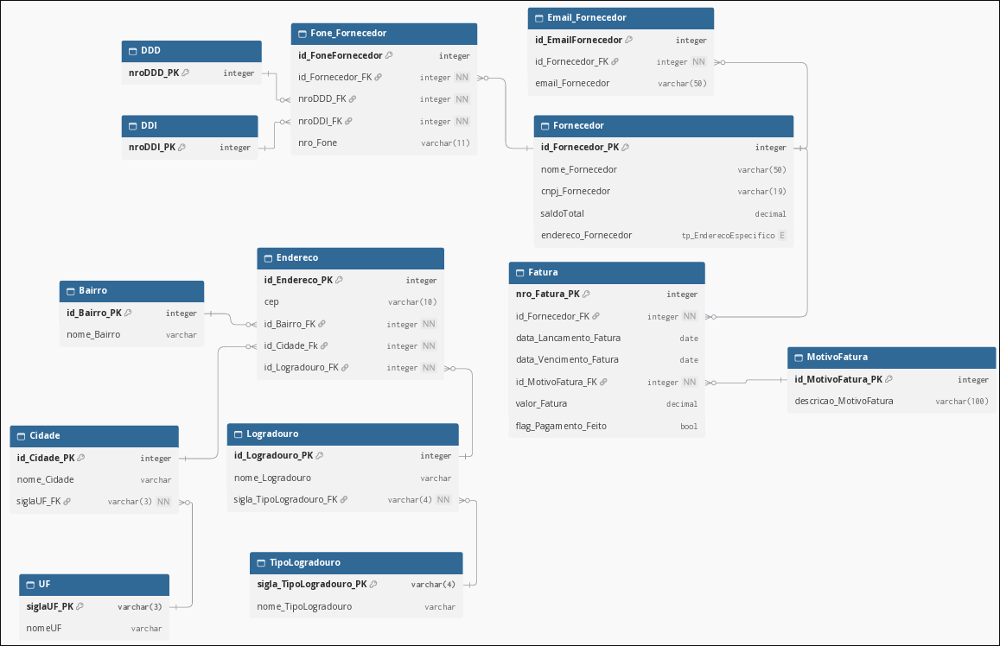
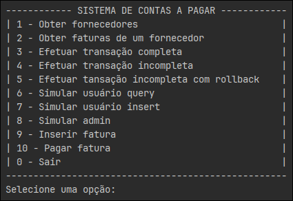
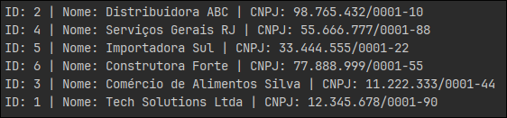
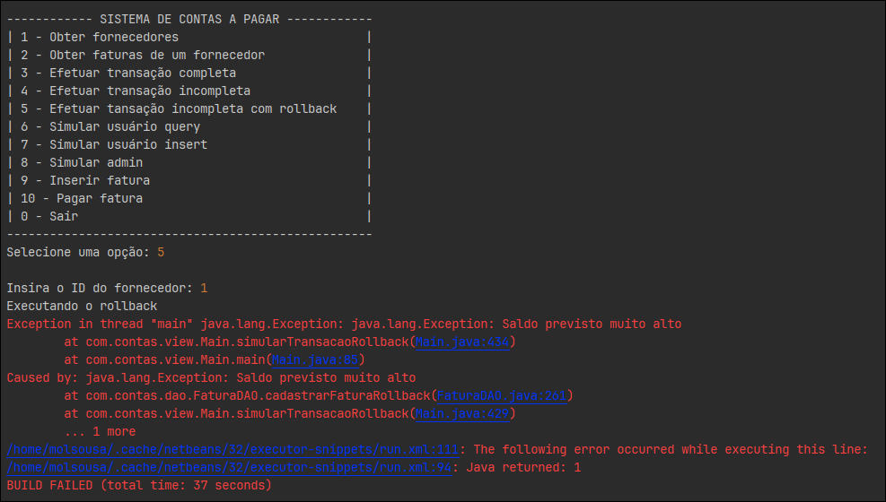

# Implementação de sistema de contas a pagar

**Disciplina:** Banco de Dados.

**Professor:** Roberto Gil Brasil.

**Estudantes:** [Julia Gabrielly](https://github.com/yuchenkkao), [Leina Yoshida](https://github.com/leinaleinaleina) e [Marcos Sousa](https://github.com/molsousa).

## Descrição

O programa foi todo implementado em Java 8 e fora utilizado o postgresql como o banco de dados. Em [sql/](./sql/) é possível consultar as tabelas e inserts que utilizamos para criar o banco.

## Modelo Entidade-Relacionamento

Este Modelo Entidade-Relacionamento contém um tipo complexo para armazenar o `nro_endereco`, `complemento` e `id_endereco`. 

Segue abaixo o MER.



## Estrutura de pacotes 

```ASCII
├── sql/
│   ├── insertsBanco.sql
│   └── tabelasBanco.sql
└── src/
    └── com/
        └── contas/
            ├── connection/
            │   ├── AdminTotal.java
            │   ├── ConnectionFactory.java
            │   ├── Root.java
            │   ├── UsuarioInsert.java
            │   └── UsuarioQuery.java
            ├── dao/
            │   ├── FaturaDAO.java
            │   ├── FornecedorDAO.java
            │   └── MotivoFaturaDAO.java
            ├── model/
            │   ├── Bairro.java
            │   ├── Cidade.java
            │   ├── DDD.java
            │   ├── DDI.java
            │   ├── EmailFornecedor.java
            │   ├── Endereco.java
            │   ├── EnderecoEspecifico.java
            │   ├── Fatura.java
            │   ├── FoneFornecedor.java
            │   ├── Fornecedor.java
            │   ├── Logradouro.java
            │   ├── MotivoFatura.java
            │   ├── TipoLogradouro.java
            │   └── UF.java
            └── view/
                └── Main.java
```

Em inserts banco também está contido a criação do tipo complexo de endereço, como se segue abaixo:

```sql
create type endereco_especifico as (
	nro_endereco int,
	complemento varchar(100),
	id_endereco int
);
```

A tabela fica dessa maneira, conforme o Modelo Entidade-Relacionamento.

```sql
create table fornecedor (
	id_fornecedor serial primary key,
	nome_fornecedor varchar(100),
	cnpj varchar(26),
	saldo_total numeric(10,2),
	endereco_residencial endereco_especifico
);
``` 

## Interface

Para esse trabalho não fora criado interface gráfica, apenas comandos no terminal.

Abaixo, segue a lista de opções durante a execução do programa.

### Lista de opções 



**1.** `Obter fornecedores`: recupera uma lista com todos os fornecedores com ID, Nome e CNPJ.

**2.** `Obter faturas de fornecedores`: recupera uma lista com todas as faturas de um fornecedor, incluso recupera o endereço completo do fornecedor, lista de emails e fones, saldo a pagar e valor de todas as faturas, inclusive as pagas.

**3.** `Efetuar transação completa`: efetua um cadastro de fatura sem erros durante a transação.

**4.** `Efetuar transação incompleta`: tenta efetuar um cadastro de fatura com um erro intencional do sistema.

**5.** `Efetuar transação incompleta com rollback`: tenta efetuar um cadastro de fatura com um erro intencional que executa um rollback no banco.

**6.** `Simular usuário query`: simula um usuário que só faz consulta e falha quando tenta fazer uma transação.

**7.** `Simular usuário insert`: simula um usuário que faz consulta, cadastro e atualização, mas falha quando tenta fazer exclusão.

**8.** `Simular admin`: simula um usuário que pode fazer todas as operações na tabela.

**9.** `Inserir fatura`: insere uma fatura no banco.

**10.** `Pagar fatura`: paga uma fatura existente, diminui o saldo conforme o valor da fatura.

---

Segue abaixo a execução da lista de fornecedores.



Segue abaixo o rollback intencional sendo executado.



---
